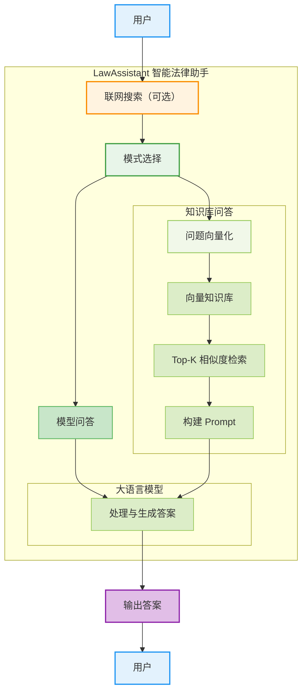
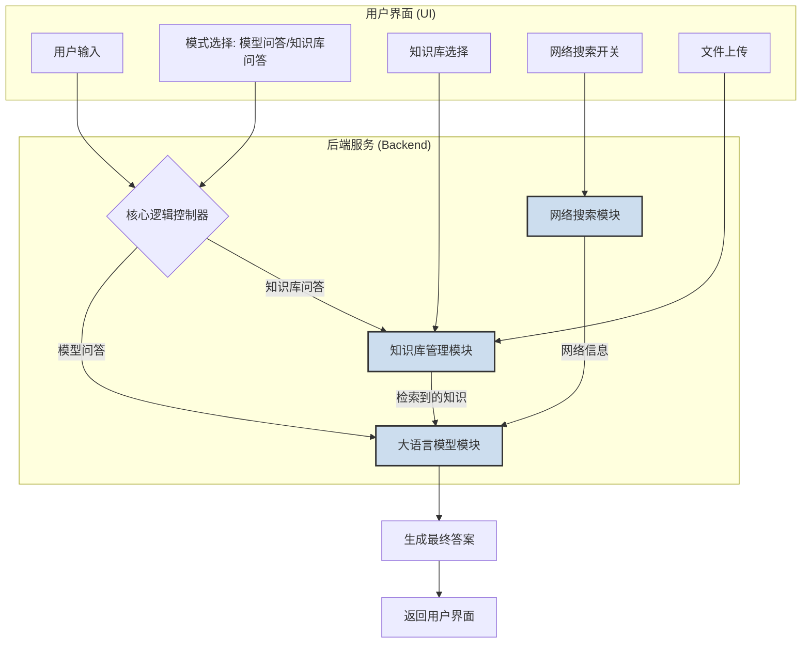
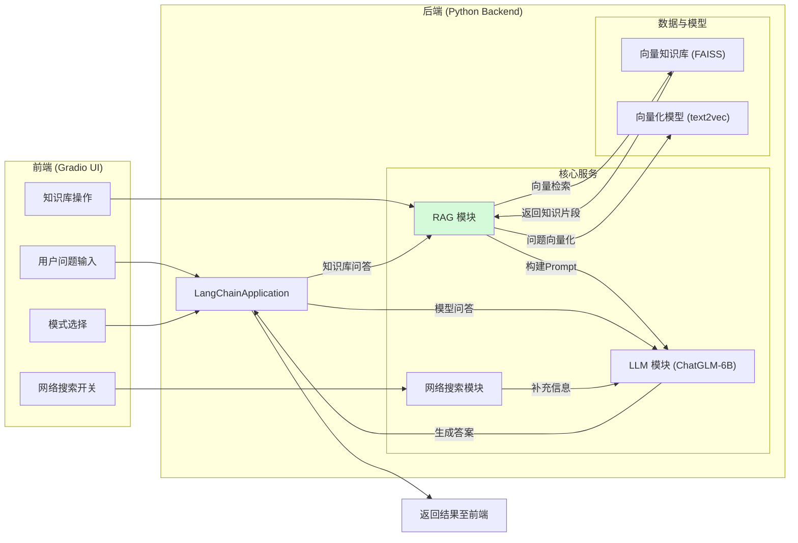
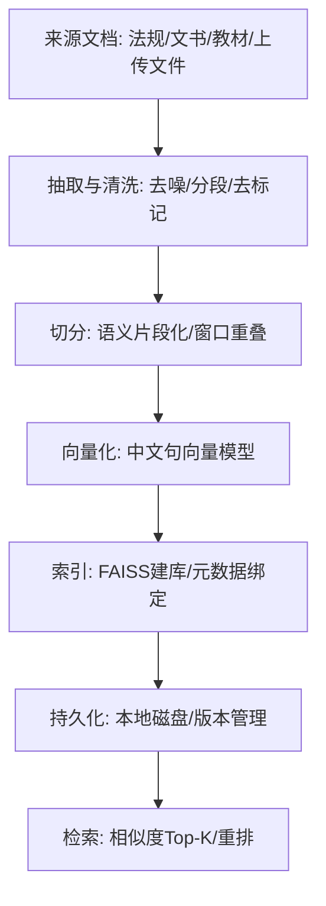
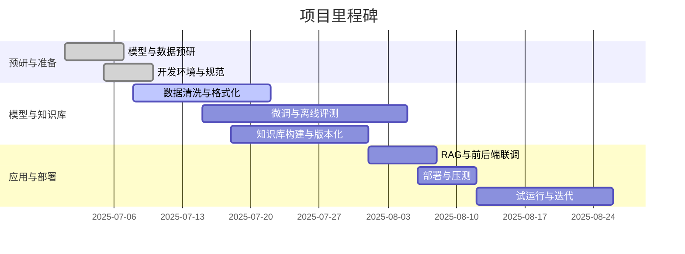
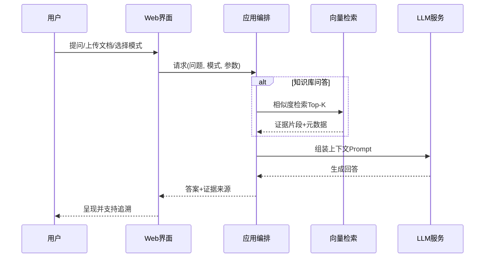

# 基于法律知识库和大语言模型的法律助手 - 项目文档

---

**版本历史**

| 序号 | 更改原因                                                     | 版本  | 作者         | 更改日期   | 备注 |
| ---- | ------------------------------------------------------------ | ----- | ------------ | ---------- | ---- |
| 1    | 创建文档，撰写项目背景、规划和可行性分析，为文档确定整体框架和格式 | 1.0.0 | 袁金敏       | 2025-07-04 |      |
| 2    | 经过小组讨论，确定项目实施方案和技术选型                     | 1.2.0 | 杨鹤鸣       | 2025-07-12 |      |
| 3    | 结合实验结果，丰富实施方案的技术细节并落实技术架构           | 1.5.0 | 张宇、牛志欣 | 2025-07-27 |      |
| 4    | 根据微调得到的法律大模型的评估结果，撰写模型评估部分         | 2.0.0 | 杨鹤鸣       | 2025-08-08 |      |
| 5    | 撰写系统功能与实现，新增架构/流程/时序图与甘特图             | 2.5.0 | 牛志欣       | 2025-08-18 |      |
| 6    | 修改口语化表述，精炼文字表达，形成最终定稿                   | 3.0.0 | 袁金敏、张宇 | 2025-08-26 |      |

---

**目录**

[TOC]

---

## 项目概况

在信息技术飞速发展的今天，法律服务行业正面临着前所未有的变革机遇。传统的法律服务模式，虽然在专业性和权威性上无可替代，但其高昂的成本、有限的服务覆盖范围以及较低的普惠性，使得普通民众在面对法律问题时常常感到无助和困惑。海量的法律条文、案例及专业文献也使得快速、准确地定位所需信息成为一大难题。

根据《2025年法律服务行业发展趋势报告》显示，传统法律服务模式长期受限于高人力依赖、低标准化、长决策周期等问题： 当前重复劳动占比高：60%以上工作时间消耗在合同审查、文书起草等重复性工作；服务体验不一致：不同律师提供的同类服务存在明显质量差异；规模化扩张困难：人均创收长期徘徊在50-80万元区间，难以突破。AI正逐步将律师从重复劳动中解放，使其专注于策略制定、商业谈判、复杂纠纷解决等高价值领域。

与此同时，人工智能，特别是大语言模型（LLM）技术的突破性进展，为我们提供了一种全新的、高效的、低成本的法律知识普及和辅助决策方案。本项目“基于法律知识库和大语言模型的法律助手”（以下简称“LawAssistant”）正是在这样的时代背景下应运而生。我们旨在利用尖端的人工智能技术，构建一个专业、普惠、高效的中文法律咨询服务平台，以弥合普通民众与专业法律服务之间的鸿沟，推动法律服务的普惠化和智能化进程。

### 项目背景与动机

#### 项目背景

##### 法律服务的现状与挑战

当前，我国的法律服务市场呈现出显著的两极分化特征。一方面，大型企业和高净值人群能够享受到顶级的、定制化的法律顾问服务；另一方面，广大的中小企业和普通民众，由于信息不对称、成本高昂等原因，难以获得及时有效的法律支持。当他们遇到劳动纠纷、合同争议、知识产权等问题时，往往求助无门，或因不了解法律程序而错失维权良机。这种服务供给的不平衡，不仅影响了个体的合法权益，也在一定程度上制约了社会的公平正义和法治建设的进程。

司法数据持续开放与数字化治理进程，为法律知识的结构化、标准化与智能化创造了条件。大量法律法规、司法解释与裁判文书的可获取性提升，但“如何高效定位与理解”成为现实难题。

##### 人工智能技术的发展机遇

近年来，以ChatGLM等为代表的大语言模型，展现出了强大的自然语言理解、生成和推理能力。这些模型通过在海量文本数据上的预训练，掌握了丰富的世界知识和语言规律。通用LLM在中文任务上表现出众，却难以保障专业问答的依据充分与可追溯，通过在特定垂直领域（如法律）的数据上进行微调，大语言模型能够被“塑造”成该领域的专家，提供专业、准确的知识问答和分析建议。这为我们开发智能法律助手提供了坚实的技术基础。将大语言模型与精细构建的法律专业知识库相结合，有望创造出既有深度又有广度的智能法律服务新范式。

##### 项目的诞生与愿景

LawAssistant项目的核心愿景是“让法律服务触手可及”。我们希望通过这个项目，将复杂的法律知识和专业的法律咨询服务，以一种简单、友好的交互方式，带给每一位有需要的用户。我们相信，技术的发展应当服务于社会福祉。通过降低法律服务的门槛，LawAssistant不仅能够帮助用户解决实际问题，维护自身权益，更能提升全社会的法律意识，为构建更加公平、透明的法治社会贡献一份力量。我们致力于将LawAssistant打造成一个值得信赖的、有温度的法律伙伴。

#### 项目灵感

本项目的灵感，源于团队在法律科技领域的持续探索和深刻洞察。我们观察到，尽管大语言模型能力强大，但通用模型在处理高度专业化的法律问题时，仍存在知识局限性、实时性不足和“模型幻觉”等问题。另一方面，简单的关键词检索又无法满足复杂法律场景下的语义理解和推理需求。如何将二者有机结合，打造一个既懂法律、又会思考的智能助手，成为了我们思考的核心。

#### 团队介绍

本项目的核心团队是一支知识结构互补、技术实力全面、充满创新活力的复合型团队。团队成员均来自985和211院校，具备扎实的研究基础和丰富的项目实战经验，对人工智能和法律科技怀有共同的热情。我们并非从零开始，具备从算法到工程、从前端到部署的全链路能力。在前期工作中，团队已成功构建了一款法律智能体（Legal Agent）的雏形，并已申请了软件著作权。该智能体基于业界前沿的`ChatGLM-4`模型和`ReAct Code`框架，能够通过自主编写并执行Python代码来调用外部工具，以完成复杂的法律查询任务。我们为此构建了涵盖公司、法院、律所、裁判文书及执行信息等多维度信息的专业知识库，并实现了智能体与知识库、网络搜索引擎的协同工作。这段宝贵的研发经历，不仅为我们积累了丰富的法律数据处理、大模型应用和智能体开发的实践经验，也为LawAssistant项目的技术路线和最终成功奠定了坚实的基础。

- **项目负责人-袁金敏**：拥有近一年的大语言模型及智能体方向的深入研究经验，主导了前期法律智能体的架构设计与核心算法研发，对模型微调、提示工程和Agent技术有较深的理解和实践。
- **前沿研究者-杨鹤鸣**：专注于大模型前沿理论研究，为项目提供最新的学术视角和理论支持，确保技术路线与学术前沿保持同步。
- **大模型工程师-张宇**：具备丰富的AI项目开发与落地经验，深度参与过大模型相关的项目，精通AI系统工程化，负责模型训练、部署优化及高性能后端服务构建。
- **全栈开发工程师-牛志欣**：熟练掌握前后端开发技术栈，具备独立构建现代化Web应用的能力。他负责项目的产品化落地，包括用户界面设计、交互逻辑实现以及整体系统的集成与测试，致力于打造良好的用户体验。

### 场景与价值

#### 市场分析

近年来，全球及中国的“法律+科技”（LegalTech）市场正经历高速增长。据Gartner预测，到2025年，法律部门的科技支出将增加到2022水平的三倍。而在中国，根据《2025年法律服务行业发展趋势报告》，2024年法律服务行业市场规模达3000亿元人民币，并以14.3%的年复合增长率持续扩张。这表明，利用技术手段提升法律服务效率和可及性，已成为行业共识和发展趋势。

然而，市场上的产品多集中于文档管理、合同审查等B端场景，直接面向广大普通民众和中小企业的普惠型智能法律咨询服务仍存在巨大的市场空白。LawAssistant正是要抓住这一机遇，切入蓝海市场。

#### 目标用户群体

LawAssistant项目的服务对象广泛，主要包括以下几类用户：

*   **普通民众**：个人用户可以随时就生活中遇到的法律问题（如劳动合同纠纷、消费者权益保护、婚姻家庭等）进行咨询，获得及时、可靠的初步建议，有效降低了法律服务的成本，提升了法律知识的可及性。他们是项目最核心的服务群体。
*   **法律专业学生**：法学院的学生可以利用LawAssistant进行案例学习、法条查询和学术研究，作为一个高效的学习和研究辅助工具。
*   **法律从业者**：律师、法官、法务助理等可以利用LawAssistant快速检索相关法律法规、案例和文献，提高工作效率，辅助案件处理。
*   **中小企业经营者**：在企业经营管理中涉及合同审查、股权结构、劳动用工等法律问题的中小微企业主或管理者。
*   **推动法治教育**：通过提供便捷的法律知识问答服务，本项目有助于在全社会范围内普及法律常识，提升公民的法律素-养和法治意识，为构建和谐、有序的法治社会贡献力量。

#### 核心应用场景

为满足不同用户的需求，LawAssistant设计了灵活多样的应用模式，覆盖了从通用问答到专业知识检索的多个核心场景：

*   **即时法律咨询**：用户通过自然语言对话，就遇到的法律问题提问，系统能够快速给出基于法律知识的、条理清晰的解答和行动建议。
*   **法律知识检索与学习**：当用户需要查询特定法条、法律概念或相关案例时，系统可以从庞大的知识库中精准定位，并以易于理解的方式呈现。
*   **案情初步分析**：用户输入案件的基本情况，系统能够依据法律逻辑，对案情进行初步分析，梳理关键要素，并提示可能的法律风险和后续步骤。
*   **法律文书辅助生成**：在未来规划中，系统还可辅助用户生成简单的法律文书初稿，如起诉状、答辩状等，极大提高文书撰写效率。




#### 社会与商业价值

LawAssistant项目具有显著的社会价值和长远的商业潜力。

在**社会价值**方面，项目致力于法律知识的普及，提升公民的法律素养，有助于从源头上减少社会矛盾和纠纷。它为经济条件有限的群体提供了获取法律援助的新途径，是促进司法公平和社会正义的有益探索。

在**商业价值**方面，随着用户基数的增长和品牌信誉的建立，LawAssistant可以探索多元化的商业模式。例如，为企业用户提供更高级的、定制化的法律风险评估和合规审查服务；与律师事务所合作，为复杂案件提供智能匹配和初步筛选，实现高效引流；或通过API接口，为其他应用提供底层的法律智能服务能力。项目的长远发展将建立在为社会创造真实价值的基础之上。

### 所需支持

为确保项目的顺利实施与持续迭代，我们需要多方面的支持。在**算力资源**方面，大模型的训练和推理需要大量的GPU计算资源，希望能够获得稳定、高性能的计算平台支持。在**数据资源**方面，高质量、多维度的法律语料是模型效果的基石，期待与法律研究机构、数据服务商等建立合作，共同构建和维护一个权威、全面的法律知识库。此外，来自法律专家和技术专家的**指导与培训**，将对项目交付质量与迭代效率的提升起到至关重要的作用。

## 项目规划

本章节将详细阐述 LawAssistant 项目在实施周期内的总体规划，包括我们期望达成的战略目标、系统需具备的核心功能、关键的技术创新以及最终的预期交付成果。

### 整体目标

LawAssistant 项目的整体目标是研发并交付一个具备专业水准、高易用性的中文智能法律助手原型系统。该系统旨在有效融合大语言模型的通用推理能力与法律领域的专业知识，为用户提供准确、可靠且易于理解的法律咨询服务。

具体而言，我们致力于实现以下几个目标：

* 构建可维护、可持续更新的本地法律知识库，并提供标准化检索能力；
* 交付高质量的法律问答系统，覆盖常见咨询、法条引用与类案检索；
* 形成可复用的评测体系与指标，持续量化模型在法律场景的实效性；
* 支持私有化与本地化部署，提供可观测性与安全合规治理能力；
* 研发面向合同审查、文书生成等高阶应用的扩展接口与方案。

### 核心功能

为了实现上述目标，LawAssistant原型系统将围绕以下核心功能进行构建：

*   **双模智能问答**：系统提供两种核心问答模式，以适应不同用户的查询需求。
    *   **模型问答模式**：直接利用经过法律领域微调后的大语言模型进行回答。此模式适用于开放性、常识性的法律问题，能够充分发挥模型的通用知识和推理能力。
    *   **知识库问答模式**：结合本地专业知识库进行检索增强生成（RAG）。当用户的问题涉及具体的法条、案例或专业概念时，系统会首先从知识库中检索最相关的知识片段，然后将其与用户问题一同提交给大语言模型，生成更为精准、有据可依的答案。

*   **动态知识库管理**：系统支持灵活的知识库加载与扩展机制。
    *   **预置知识库加载**：内置了“刑法法条”、“刑法书籍”等多个预处理好的专业向量知识库，用户可根据需要一键加载，快速切换知识领域。
    *   **用户自定义知识库**：提供文件上传功能，支持用户将自己的文档（如 `.pdf`, `.docx`, `.txt` 等格式）上传至系统，系统会自动将其处理并构建成新的向量知识库，实现个性化的知识增强。

*   **混合信息源检索**：为了确保答案的时效性和全面性，系统集成了网络搜索功能。在处理需要最新信息（如新颁布的法规、近期热点案例等）的问题时，系统可以启动网络搜索引擎，将实时获取的网络信息作为补充材料，供大语言模型参考，从而打破离线知识库的信息壁垒。

*图 2-1 系统核心功能架构图*



### 技术创新点

本项目不仅是现有技术的简单应用，更在多个方面进行了深入的探索和创新，力求为垂直领域大模型的发展提供有价值的参考。

#### 垂直领域知识与大模型的深度融合

传统的大模型微调常常面临“灾难性遗忘”问题，即在学习专业知识后，模型原有的通用能力会下降。为解决此问题，我们提出并实践了一套**混合数据微调策略**。我们没有仅仅使用单一的法律文本，而是精心构建了一个多层次、多来源的训练数据集，它融合了：

*   **通用指令数据**（如 BELLE）：用以保持模型的通用对话和指令遵循能力。
*   **专业问答数据**（如 LawGPT_zh）：让模型学习法律领域的特定问答范式。
*   **法律法规文本**：增强模型对法条的精确记忆和理解。
*   **法律文书**：使模型熟悉真实案例的语言风格和裁判逻辑。

通过这种方式，我们旨在实现模型在法律专业性与通用能力之间的最佳平衡，使其既是“法律专家”，又是“沟通高手”。

#### 混合检索增强生成（HRAG）

标准的检索增强生成（RAG）通常依赖于一个静态的本地知识库。然而，法律领域知识更新快，且用户的提问范围可能超出预置知识库的范畴。为此，我们设计并实现了一种**混合检索增强生成（Hybrid RAG, HRAG）**架构。该架构能够智能地结合两种信息源：

1.  **本地向量知识库**：提供稳定、权威、深度的专业知识。用户可以动态加载不同的法律知识库（如刑法法条、刑法书籍），系统能够根据用户问题，在知识库中进行向量检索，并将检索到的相关知识融入到提供给大模型的上下文中，从而生成更为精准、有据可依的回答，有效缓解了模型幻觉问题。
2.  **实时网络搜索**：提供最新、最广、动态更新的外部信息，弥补本地知识库的时效性不足。当用户的问题涉及最新法规、热点案例或其他动态信息时，系统可以调用网络搜索引擎，获取相关网页内容，并将其作为补充材料提供给大模型参考。

系统可以根据用户问题的特点，动态地决定是仅使用本地知识、仅使用网络搜索，还是将二者结合，从而为模型提供最全面、最相关的上下文信息，显著提升了答案的准确性和时效性。

#### 多样化微调策略的探索与实践

针对如何以最高效的方式将大模型适配到法律领域这一核心问题，本项目没有满足于单一的技术路线，而是对当前主流的多种微调方法进行了系统的实现和对比实验。我们深入实践了：

*   **全量微调（Full Finetune）** 的变体（如 Freeze）：通过冻结部分底层参数，只训练顶层网络，在保证效果的同时降低了训练成本。
*   **参数高效微调（Parameter-Efficient Fine-Tuning, PEFT）** 的代表性方法，如 **LoRA** 和 **P-Tuning v2**。

这种多路径的探索，使我们能够深入理解不同微调策略在法律领域的性能表现、资源开销和适用场景，为后续选择最优技术方案提供了宝贵的经验数据和深刻洞见。

## 实施方案

本章节将深入探讨 LawAssistant 项目的具体技术实现路径，详细阐述系统的总体架构、数据处理流程、模型构建策略、知识库实现细节以及最终的系统部署方案。

### 可行性分析

#### 技术可行性分析

本项目的技术可行性建立在成熟的技术栈、前沿的算法以及团队已有的研发基础之上。

1.  **大语言模型技术成熟度**：以ChatGLM、Llama等为代表的开源大语言模型已经展现出强大的基础能力，并形成了活跃的社区生态。围绕这些模型的微调、量化、部署等工具链也日趋完善，为我们进行二次开发和领域适配提供了坚实的基础。
2.  **检索增强生成（RAG）方案**：RAG作为当前缓解模型幻觉、引入外部知识的主流技术方案，其理论和实践都已相当成熟。LangChain、LlamaIndex等开源框架极大地降低了构建RAG应用的复杂度。我们提出的HRAG是对其的进一步优化和创新，技术上完全可以实现。
3.  **团队技术储备**：如前所述，团队成员在AI算法、大模型工程、全栈开发等方面拥有全面的技术能力和丰富的项目经验。尤其是在法律智能体项目中的成功实践，已经验证了我们整合大模型、知识库和外部工具的技术能力，为本项目的顺利实施提供了有力的保障。
4.  **数据获取与处理**：法律领域的公开数据资源相对丰富，包括法律法规、司法解释、裁判文书等。团队已具备通过网络爬虫、公开数据集等渠道获取并处理这些数据的能力，能够为模型微调和知识库构建提供充足的“养料”。

#### 经济可行性分析

本项目具有低成本启动和高潜在回报的经济特性。

*   **成本控制**：
    *   **人力成本**：项目由核心团队成员自主研发，初期无新增人力成本。
    *   **算力成本**：我们将充分利用开源模型和参数高效微调技术（如LoRA），大幅降低模型训练所需的算力资源。同时，实验室提供了租赁服务器的费用，可进一步控制成本。
    *   **数据成本**：主要依赖公开的法律数据和团队自建的知识库，数据获取成本极低。

*   **潜在收益**：
    *   **短期价值**：作为一项具有创新性和社会价值的科研项目，有望获得学术竞赛奖项、科研项目立项或创业孵化支持，带来直接的资金或资源奖励。
    *   **长期价值**：项目原型验证成功后，具备向商业化产品转化的巨大潜力。如前文“商业价值”部分所述，可通过提供增值服务、API授权、项目合作等多种方式实现盈利，市场前景广阔。

#### 运行可行性分析

*   **法律与伦理**：项目严格遵守数据隐私和信息安全相关法律法规。所用数据均为公开信息或经脱敏处理，不涉及用户个人隐私。模型生成内容会明确声明其非正式法律意见的性质，提示用户在重要事务中咨询专业律师，规避法律风险。
*   **操作可行性**：项目成果将以一个直观易用的Web应用形式呈现，用户无需复杂的配置即可通过浏览器访问和使用。团队的全栈开发能力确保了产品的可操作性和良好的用户体验。
*   **部署与维护**：我们将采用容器化技术（如Docker）进行部署，确保环境的一致性和可移植性。初期可部署在校内服务器或云平台的免费额度上，随着用户量增长，可平滑扩展至更高性能的服务器，运维成本可控。

### 总体技术架构

LawAssistant 的核心架构基于当前业界先进的“检索增强生成”（Retrieval-Augmented Generation, RAG）思想，该架构旨在将大语言模型强大的推理生成能力与外部知识库精准、可靠的知识检索能力相结合，从而在保证回答专业性的同时，有效缓解模型的“幻觉”问题。

系统整体上可以划分为前后端分离的两个主要部分：

*   **前端交互层 (Frontend)**：我们采用轻量级的 `Gradio` 框架快速构建了一个功能丰富的 Web 用户界面。该界面为用户提供了所有功能的图形化操作入口，包括输入问题、选择问答模式（“模型问答”或“知识库问答”）、加载知识库、开启网络搜索、上传自定义文档等。前端负责接收用户的操作指令，并将其发送给后端服务进行处理，同时将后端返回的结果（包括最终答案和参考依据）清晰地呈现给用户。

*   **后端服务层 (Backend)**：后端是整个系统的“大脑”，其核心是基于 `LangChain` 框架构建的 `LangChainApplication` 应用实例。该应用整合了多个关键的功能模块：
    *   **大语言模型 (LLM) 模块**：封装了经过法律领域微调的 `ChatGLM-6B` 模型，这是一个具备强大中文理解和生成能力的语言模型，是本项目进行领域知识微调的基础，负责根据最终构建的 Prompt 生成回答。
    *   **知识库管理与检索模块**：负责加载、管理和查询本地的向量化知识库，其集成了以 `text2vec-large-chinese` 为核心的文本向量化能力和基于 `FAISS` 的高效向量检索引擎，可实现海量法律文本的毫秒级高效检索。
    *   **网络搜索模块**：通过调用外部搜索引擎（如 DuckDuckGo）的 API，为系统提供获取实时网络信息的能力。
    *   **核心逻辑控制器**：作为总调度中心，它接收前端请求，根据用户选择的模式（模型问答或知识库问答），协同调用上述各个模块，完成从问题理解、信息检索、上下文构建到答案生成的完整流程。

    在“知识库问答”模式下，系统首先利用文本向量化模型将用户问题转换为向量，在指定的本地知识库中进行高效的相似度检索，找出最相关的知识片段。然后，将这些检索到的内容与原始问题、聊天历史等信息整合成一个丰富的上下文提示（Prompt），提交给大语言模型。最终，大语言模型基于该提示生成精准、详实且有据可依的回答，返回给前端呈现给用户。该架构还支持动态加载不同的知识库以及集成外部网络搜索，进一步拓展了信息获取的广度和深度。




### 技术细节

#### 数据采集与处理方案

高质量的数据是训练出优秀领域大模型的基石。为了将通用的`ChatGLM-6B`模型改造为专业的法律大模型，我们构建了一个全面且多样化的数据集，以确保模型既能学习到专业的法律知识，又不会丧失其原有的通用语言能力。

##### 数据源

我们的训练数据主要由以下几个部分构成，旨在实现通用能力与专业知识的平衡：

*   **通用领域数据**：我们引入了约150万条的大规模的中文指令数据集 **BELLE**，其目的是在微调过程中维持模型原有的、强大的通用语言理解、逻辑推理和指令遵循能力，防止“灾难性遗忘”。
*   **法律问答数据**：这是数据集的核心。我们整合了多个高质量的公开法律问答语料，包括 **LawGPT_zh**（包含单轮及带法律依据的情景问答）、**Lawyer LLaMA**（包含法考数据和法律指令），并自行爬取和清洗了**华律网**和**百度知道法律板块**的数万条真实用户问答。这部分数据使模型能够学习真实世界法律咨询的范式。
*   **法律法规与书籍**：为了让模型精准地理解和引用法律条文，我们引入了结构化的**法律法规文本**（源自`LawRefBook/Laws`项目）和专业的**法律参考书籍**（源自清华大学`JEC-QA`数据集）。
*   **法律文书**：为了让模型学习法官的裁判逻辑和语言风格，我们收集了约5万份**中国裁判文书网**的公开文书，并利用正则表达式提取出“事实查明”和“本院认为”部分，构建了模拟判决分析的训练样本。

##### 数据处理流程

所有收集到的原始数据都经过了统一的格式化处理，以符合指令微调（Instruction Tuning）的要求。我们将不同来源的数据统一处理成如下的JSON格式：

```json
{
  "instruction": "一个描述任务的指令",
  "input": "任务的输入（可选，对于需要上下文的问题）",
  "answer": "期望模型生成的回答"
}
```

例如，对于一条法律法规数据，我们会将其构造成：

> `{"instruction": "给出以下法条的具体内容:", "input": "畜禽规模养殖污染防治条例第二条", "answer": "畜禽规模养殖污染防治条例第二条 本条例适用于畜禽养殖场、养殖小区的养殖污染防治..."}`

对于一个法律文书，我们会将其构造成：

> `{"instruction": "你现在是一个精通中国法律的法官，请对以下案件做出分析:", "input": "经审理查明：...", "answer": "本院认为，..."}`

通过这种方式，我们将不同类型的知识统一转化为模型可以理解和学习的“指令-回答”对，为后续的模型微调做好了充分准备。

#### 模型构建与微调方案

##### 基础模型选型

我们选择 **ChatGLM-6B** 作为我们的基础模型。这是一款由清华大学知识工程与数据挖掘小组（KEG）和智谱AI共同研发的、开源的中英双语对话模型。选择它的主要原因在于：它在中文语言任务上表现出色，拥有强大的生成和理解能力；其模型结构对学术研究和开源社区友好；6B的参数量在保证了强大能力的同时，对硬件资源的要求相对可控，适合进行多种微调实验。

##### 领域知识微调

我们在配备了7张40G A100 GPU的服务器上，利用 `DeepSpeed` 分布式训练框架，对基础模型进行了深度微调。为了系统性地评估不同微调策略的效果，我们实践并对比了以下三种主流方法：

1.  **LoRA (Low-Rank Adaptation)**：这是一种参数高效微调（PEFT）技术。它通过在模型原有的权重矩阵旁边，并联一个低秩的“旁路”网络来进行训练，在整个微调过程中，原始模型参数保持冻结，仅更新这个“旁路”网络的参数。这种方法极大地减少了需要训练的参数量（本项目中约734万），从而显著降低了显存消耗和训练时间。我们设置 `lora_rank=16`，学习率为 `5e-4`。

2.  **P-Tuning v2**：这是另一种PEFT技术。它为模型的每一层都添加了可训练的、连续的提示（Prompt）前缀。在训练时，模型主体参数被冻结，只有这些Prompt前缀被更新。相比于LoRA，P-Tuning v2的训练参数量稍多（本项目中约9.5亿），理论上能对模型的行为进行更深层次的调整。我们设置 `pre_seq_len=128`，学习率为 `5e-4`。

3.  **Finetune (部分层全参数微调)**：为了在效果和资源之间取得平衡，我们没有对模型的全部参数进行微调，而是采取了“冻结底层、微调顶层”的策略。具体来说，我们冻结了ChatGLM-6B模型的大部分底层Transformer层，仅对最顶部的5层（layer 23至27）进行全参数的更新。这种方法训练的参数量最多（约10亿），理论上能最大程度地将领域知识融入模型，但资源消耗也最大。我们为此设置了较小的学习率 `1e-5`，以进行稳定、精细的调整。

#### 知识库构建与检索方案

##### 知识获取与表征

LawAssistant的知识库问答能力，依赖于一个高效的本地知识库构建流程。该流程由 `demo/create_knowledge.py` 脚本实现，旨在将非结构化的文档转化为可供快速检索的结构化知识。

1.  **文档加载**：系统能够从指定的目录中加载多种格式的源文件，包括 `.txt`, `.md`, `.docx`, 和 `.pdf`。这使得用户可以方便地将自己收集的法律书籍、研究报告、案件材料等纳入知识库。
2.  **文本切分：由于语言模型处理的文本长度有限，且为了检索的精确性，长文档必须被切分成更小的、语义完整的单元（Chunks）。我们采用递归字符文本切分器，设定合适的块大小和重叠度，确保切分后的文本块既不会过长，又能保持上下文的连续性。

##### 向量化与存储

文本被切分后，需要被转化为机器能够理解的数学形式——向量。

1.  **文本向量化：我们选用 `text2vec-large-chinese` 模型作为我们的文本向量化工具。这是一个在大量中文语料上训练的、表现优异的句向量模型。它能够将每一个文本块精准地映射到一个高维（通常是1024维）的向量空间中。在这个空间里，语义相近的文本块，其对应的向量在空间位置上也更接近。
2.  **向量存储与索引**：为了实现对海量文本向量的快速检索，我们使用 `FAISS` (Facebook AI Similarity Search) 库。FAISS是一个专门为稠密向量的相似性搜索和聚类而设计的库，它能够处理十亿级别的向量索引。我们将所有文本块的向量存入FAISS索引中，并将该索引与原文块的映射关系一同持久化存储在本地磁盘上（位于 `demo/cache` 目录），形成一个完整的、可随时加载的知识库。

##### 知识库的更新与维护

本系统支持动态的知识库管理。用户不仅可以加载预置的知识库（如“刑法法条”），还可以通过前端界面上传自己的文档。上传的文档会触发后台的知识库构建流程，将其增量地处理并合并到现有的或一个新的知识库中，实现了知识的个性化扩展和持续更新。

##### 知识检索与整合

在“知识库问答”模式下，系统执行以下检索与整合流程：
1.  **查询向量化**：用户输入问题后，系统同样使用`text2vec-large-chinese`模型将其转换为查询向量。
2.  **相似度检索**：在用户指定的已加载知识库中，利用查询向量进行相似度搜索，检索出与问题最相关的`top_k`个文本块。
3.  **上下文构建**：将检索到的文本块作为核心参考知识，结合用户的原始问题、当前对话的上下文历史以及可能的网络搜索结果，共同构建一个内容丰富的Prompt。
4.  **生成回答**：将此Prompt发送给微调后的`ChatGLM-6B`模型，模型基于提供的上下文信息，生成最终的回答。这一过程确保了回答不仅流畅自然，而且紧密围绕相关法律知识，内容更加可靠。

文本处理与索引流程图



### 计划与分工

项目按“预研与准备—模型与知识库—应用与部署—试运行与迭代”推进，角色覆盖项目负责人、算法工程师、后端工程师、前端/全栈工程师与运维/测试工程师。

*   **项目负责人 (袁金敏)**：负责整体规划、技术选型、进度把控和跨团队协调。
*   **算法工程师 (杨鹤鸣、张宇)**：
    *   **数据方向**：负责法律数据的搜集、清洗、格式化处理，构建高质量的训练数据集。
    *   **模型方向**：负责实现和执行多种微调方案（LoRA, P-Tuning, Finetune），进行模型训练、评估和调优。
*   **后端开发工程师 (牛志欣)**：负责利用 `LangChain` 等框架，搭建后端服务，实现RAG流程，封装API接口，并集成知识库和网络搜索等功能。
*   **前端/全栈工程师 (牛志欣)**：负责使用 `Gradio` 构建用户交互界面，进行前端组件布局、功能绑定和体验优化。

项目可划分为以下几个主要阶段：
1.  **第一阶段：技术预研与基础准备 (1周)**：调研大模型微调技术，选定基础模型，完成开发环境搭建，搜集并初步处理各类法律数据。
2.  **第二阶段：模型微调与评估 (3周)**：并行开展多种微调实验，对产出模型进行系统性的效果评估，确定最优模型版本。
3.  **第三阶段：后端服务开发 (1周)**：搭建RAG后端架构，实现知识库的构建、加载与检索功能，集成网络搜索。
4.  **第四阶段：前端开发与系统集成 (1周)**：开发Gradio交互界面，与后端服务进行联调测试，修复Bug，优化用户体验。
5.  **第五阶段：文档撰写 (1周)**：完成项目文档的撰写、整理代码和模型。




## 模型评估

### 评测范围介绍


我们采取了LAiW（A Chinese Legal Large Language Models Benchmark）数据集作为评测基准，LAiW数据集在 <strong>法学专家与人工智能专家</strong> 的共同努力下，从法学角度和可实现性上对法律 NLP的能力进行划分。如上图所示，LAiW将法律大模型的评估分成了<strong>3</strong>大能力，共计<strong>14</strong>个基础任务：

- 基础信息检索能力（Basic Information Retrieval，BIR）：评测法律基础任务、 NLP 基础任务和法律信息抽取的能力，包括法条推送、要素识别、命名实体识别、司法要点摘要和案件识别 5 个基础任务
- 法律原则推理能力（Legal Foundation Inference，LFI）：评测大模型对法律领域知识的基础应用能力，包括争议焦点挖掘、类案匹配、罪名预测、刑期预测和民事裁判预测和法律问答 6 个基础任务
- 法律高级应用能力（Complex Legal Application，CLA）：评测大模型对法律领域知识的复杂应用能力，包括司法说理生成、案情理解和法律咨询 3 个基础任务
  

下面是各评测任务的简要介绍

<table>
  <tr>
  <td>能力</td>
  <td>任务</td>
  <td>介绍</td>
  </tr>
  <tr>
    <td rowspan="5">基础信息检索</td>
    <td>法条推送</td>
    <td>该任务是司法实践应用上的基础任务，在提供法律领域的智能化支持和辅助决策上起着重要作用，旨在根据案件描述给出其相关法条</td>
  </tr>
  <tr>
    <td>要素识别</td>
    <td>在司法领域，案件要素识别任务的主要目的是从案件描述中自动提取关键事实描述。在给定司法文书的相关段落之后，系统对每句话进行分析和判断，以确定关键的案件要素</td>
  </tr>
  <tr>
    <td>命名实体识别</td>
    <td>从各种法律文件中提取具有司法特征的名词和短语并进行合并的过程，如与赃物、嫌疑人有关的法律文件</td>
  </tr>
  <tr>
    <td>司法要点摘要</td>
    <td>裁判文书是人民法院公开审判活动、裁判理由、裁判依据和裁判结果的重要载体。司法摘要则是对裁判文书的内容进行压缩、归纳和总结，反映案件审理过程中的裁判过程、事实、理由和判决依据等</td>
  </tr>
  <tr>
    <td>案件识别</td>
    <td>民事案件和刑事案件是两种不同类型的法律案件。民事案件是解决个人纠纷和维护权益的法律程序，刑事案件是为了维护社会秩序和惩罚犯罪行为的法律程序。本任务旨在根据相关的案件描述判断其为刑事案件还是民事案件</td>
  </tr>
  <tr>
    <td rowspan="5">法律原则推理</td>
    <td>争议焦点挖掘</td>
    <td>在法院的庭审过程中，裁判文书起着记录辩、诉双方观点证据的重要作用。本任务旨在抽取出裁判文书中辩方诉方之间的逻辑交互论点对，即争议焦点</td>
  </tr>
  <tr>
    <td>类案匹配</td>
    <td>司法裁决通常是根据过去类似的代表性案例做出的。因此，如何识别最相似的案件是判决中一个首要关注的问题</td>
  </tr>
  <tr>
    <td>刑事裁判预测</td>
    <td>根据事实描述自动预测裁判结果，本任务旨在根据案件事实、证据和适用的法律，对被告人的定罪与否以及可能的刑期进行预测，因此分为罪名预测和刑期预测两类任务</td>
  </tr>
  <tr>
    <td>民事裁判预测</td>
    <td>通过分析案件相关信息和相关法律规定，预测民事诉讼中可能的判决结果或争议的解决方式。本任务旨在使用事实描述来预测其对原告诉请的裁判</td>
  </tr>
  <tr>
    <td>法律问答</td>
    <td>司法考试作为我国最难的考试，也是法律工作者生涯中极其重要的考试。本任务是针对国家司法考试的客观问答任务，包括单选题和多选题</td>
  </tr>
  <tr>
    <td rowspan="3">法律高级应用</td>
    <td>司法说理生成</td>
    <td>人民法院在认定案件事实的基础上需要就判决理由作出进一步的阐述。本任务旨在根据案件事实描述生成相关的司法说理文本</td>
  </tr>
  <tr>
    <td>案情理解</td>
    <td>通过机器智能化地阅读理解裁判文书，可以更快速、便捷地辅助法官、律师以及普通大众获取所需信息。本任务是基于中文裁判文书的阅读理解，具体来说，模型需要基于裁判文书的案件相关描述所提出的问题而作出合理合规的回答</td>
  </tr>
  <tr>
    <td>法律咨询</td>
    <td>涵盖广泛的法律领域，包括但不限于刑法、民法、商法、劳动法、知识产权法、家庭法等。本任务旨在根据用户提供的有关法律问题，考虑适用的法律法规、相关判例和法律解释，并结合具体情况给出准确、清晰和可靠的答案</td>
  </tr>
</table>

### 评测数据集构成

LAiW具体任务和数据集信息如下表所示：

<table>
  <tr>
    <td>能力层级</td>
    <td>任务</td>
    <td>主要数据集</td>
    <td>评测数据集</td>
    <td>数据集大小</td>
    <td>类别</td>
  </tr>
  <tr>
    <td rowspan="5">基础信息检索</td>
    <td>法条推送</td>
    <td>CAIL-2018</td>
    <td><a href="https://huggingface.co/datasets/daishen/legal-ar">legal_ar</a></td>
    <td>1,000</td>
    <td>分类</td>
  </tr>
  <tr>
    <td>要素识别</td>
    <td>CAIL-2019</td>
    <td><a href="https://huggingface.co/datasets/daishen/legal-er">legal_er</a></td>
    <td>1,000</td>
    <td>分类</td>
  </tr>
  <tr>
    <td>命名实体识别</td>
    <td>CAIL-2021</td>
    <td><a href="https://huggingface.co/datasets/daishen/legal-ner">legal_ner</a></td>
    <td>1040</td>
    <td>命名实体识别</td>
  </tr>
  <tr>
    <td>司法要点摘要</td>
    <td>CAIL-2020</td>
    <td><a href="https://huggingface.co/datasets/daishen/legal-js">legal_js</a></td>
    <td>364</td>
    <td>文本生成</td>
  </tr>
  <tr>
    <td>案件识别</td>
    <td>CJRC</td>
    <td><a href="https://huggingface.co/datasets/daishen/legal-cr">legal_cr</a></td>
    <td>2,000</td>
    <td>分类</td>
  </tr>
  <tr>
    <td rowspan="6">法律原则推理</td>
    <td>争议焦点挖掘</td>
    <td>LAIC-2021</td>
    <td><a href="https://huggingface.co/datasets/daishen/legal-cfm">legal_cfm</a></td>
    <td>306</td>
    <td>分类</td>
  </tr>
  <tr>
    <td>类案匹配</td>
    <td>CAIL-2019</td>
    <td><a href="https://huggingface.co/datasets/daishen/legal-scm">legal_scm</a></td>
    <td>260</td>
    <td>分类</td>
  </tr>
  <tr>
    <td>罪名预测</td>
    <td>Criminal-S</td>
    <td><a href="https://huggingface.co/datasets/daishen/legal-cp">legal_cp</a></td>
    <td>827</td>
    <td>分类</td>
  </tr>
  <tr>
  <td>刑期预测</td>
    <td>MLMN</td>
    <td><a href="https://huggingface.co/datasets/daishen/legal-ptp">legal_ptp</a></td>
    <td>349</td>
    <td>分类</td>
  </tr>
  <tr>
    <td>民事裁判预测</td>
    <td>MSJudeg</td>
    <td><a href="https://huggingface.co/datasets/daishen/legal-ctp">legal_ctp</a></td>
    <td>800</td>
    <td>分类</td>
  </tr>
  <tr>
    <td>法律问答</td>
    <td>JEC-QA</td>
    <td><a href="https://huggingface.co/datasets/daishen/legal-lqa">legal_lqa</a></td>
    <td>855</td>
    <td>分类</td>
  </tr>
  <tr>
    <td rowspan="3">法律高级应用</td>
    <td>司法说理生成</td>
    <td>AC-NLG</td>
    <td><a href="https://huggingface.co/datasets/daishen/legal-jrg">legal_jrg</a></td>
    <td>834</td>
    <td>文本生成</td>
  </tr>
  <tr>
    <td>案情理解</td>
    <td>CJRC</td>
    <td><a href="https://huggingface.co/datasets/daishen/legal-cu">legal_cu</a></td>
    <td>1,054</td>
    <td>文本生成</td>
  </tr>
  <tr>
    <td>法律咨询</td>
    <td>CrimeKgAssitant</td>
    <td><a href="https://huggingface.co/datasets/daishen/legal-lc">legal_lc</a></td>
    <td>916</td>
    <td>文本生成</td>
  </tr>
</table>

### 评分机制

#### 任务得分

$$
S_{(Task)} = \begin{cases}
    F1 * 100, & \text{If }\quad Task\quad\in\quad Classification \\
    \frac{1}{3}*(R1 + R2 + RL) * 100, & \text{If }\quad Task \quad\in\quad Text\quad Generation \\
    Acc * 100, & \text{If }\quad Task\quad\in\quad NER
\end{cases}
$$

评测基准主要包含分类任务，文本生成和命名实体识别任务三类。分类任务采用F1值；文本生成任务采用其Rouge1，Rouge2和RougeL的均值；法律NER任务采用法律实体的提取准确率Accuracy作为其得分。

#### 模型得分

对于单个大模型，我们首先计算每个阶段的任务平均分数作为其该项法律能力得分。然后取三项法律能力得分的均值作为大模型的最终评测分数。

按照大模型[评分机制](#评分机制)的计算方式，现阶段我们评测了5个主流法律大模型和6个通用大模型，模型得分如下：

| 模型 | 参数 | 模型领域 | 总分 | BIR | LFI | CLA | 基模型 |
| :---:| :---: | :---: | :---: | :---: | :---: | :---: | :---: |
| LawAssistant(ours) | 6B | 法律 | **31.31** | 41.32 | 8.88 | 43.73 | [ChatGLM-6B](https://huggingface.co/THUDM/chatglm-6b) |
| [ChatLaw](https://huggingface.co/JessyTsu1/ChatLaw-13B)  | 13B | 法律 | 25.77 | **58.02** | 12.54 | 6.74 | [Ziya-LLaMA-13B](https://huggingface.co/IDEA-CCNL/Ziya-LLaMA-13B-v1) |
| [Llama2-Chat](https://huggingface.co/meta-llama/Llama-2-7b-chat-hf)    | 7B | 通用 | 27.76 | 31.86 | 12.77 | 38.64 | - |
| [Lawyer-LLaMA](https://github.com/AndrewZhe/lawyer-llama/tree/main?tab=readme-ov-file)  | 13B | 法律 | 29.25 | 30.85 | 6.39 | **50.50** | [Chinese-LLaMA-13B](https://github.com/ymcui/Chinese-LLaMA-Alpaca) |
| [Chinese-LLaMA](https://github.com/ymcui/Chinese-LLaMA-Alpaca) | 13B | 通用 | 24.99 | 21.02 | **19.16** | 34.80 | Llama-13B |
| [Chinese-LLaMA](https://github.com/ymcui/Chinese-LLaMA-Alpaca) | 7B | 通用 | 24.91 | 22.32 | 18.25 | 34.16 | Llama-7B |
| [Baichuan](https://github.com/baichuan-inc/Baichuan-7B) | 7B | 通用 | 22.51 | 21.20 | 15.46 | 30.86 | - |
| [LaWGPT](https://github.com/pengxiao-song/LaWGPT)      | 7B | 法律 | 22.69 | 15.47 | 14.27 | 38.32 | [Chinese-LLaMA-7B](https://github.com/ymcui/Chinese-LLaMA-Alpaca) |
| Llama | 13B | 通用 | 21.00 | 18.51 | 15.08 | 29.40 | - |
| [Wisdom-Interrogatory](https://github.com/zhihaiLLM/wisdomInterrogatory) | 7B | 法律 | 18.83 | 12.66 | 10.45 | 33.37 | [Baichuan-7B](https://huggingface.co/baichuan-inc/Baichuan-7B) |
| Llama | 7B | 通用 | 16.35 | 11.12 | 15.40 | 22.54 | - |

从结果看出，我们的模型综合得分超过了所有基线模型，以较小的GPU资源占用和算力消耗取得了较好的结果，同时在三大子任务中都取得了不错的结果。

## 系统功能与实现

### 核心功能模块

本系统围绕大语言模型的应用，设计并实现了两大核心功能模块，以满足不同场景下的法律咨询需求。

#### 模型问答模块

“模型问答”是系统的基础功能模块。在此模式下，用户的提问将直接发送给经过法律领域微调的`ChatGLM-6B`大语言模型进行处理。该模块充分利用了模型在训练过程中学到的庞大法律知识体系和强大的自然语言理解与生成能力。

其主要实现逻辑位于`LangChainApplication`类的`get_llm_answer`方法中。当用户选择此模式并输入问题后，系统会构建一个相对简单的Prompt，主要包含用户的直接提问。如果用户同时开启了网络搜索选项，系统会先通过`search_web`方法利用搜索引擎（如DuckDuckGo）获取与问题相关的实时网络信息，并将这些信息作为额外的上下文补充到Prompt中。随后，这个Prompt被送入语言模型，生成回答。

此模块适用于处理开放性、一般性的法律问题，或当用户希望获得一个不局限于特定知识库、更具创造性和发散性的回答时。它能够模拟法律专家的口吻，进行法律概念解释、法律理论探讨等。

#### 知识库问答模块

“知识库问答”是本项目的特色与核心优势所在，它通过结合本地知识库的精确检索，为用户的提问提供更为精准、有据可依的回答。

该模块的实现由`LangChainApplication`类的`get_knowledge_based_answer`方法负责。其工作流程体现了典型的检索增强生成（RAG）思想：
1.  **加载知识库**：用户首先需要在界面上选择一个预先构建好的本地知识库（如“刑法法条”或“刑法书籍”）并点击“加载知识库”按钮。该操作会触发`set_knowledge`函数，调用`source_service.load_vector_store`方法，将存储在指定路径的向量数据库加载到内存中，准备进行检索。
2.  **问题检索**：当用户在此模式下提问时，系统首先调用`source_service`中的向量检索功能，在已加载的知识库中查找与用户问题最相关的`top_k`个知识片段。
3.  **上下文整合与生成**：系统将检索到的这些知识片段，连同用户的原始问题、可选的聊天历史以及网络搜索内容，整合成一个内容丰富的Prompt。这个Prompt被精心设计，以引导大语言模型重点参考所提供的知识库内容来组织回答。
4.  **结果呈现**：模型生成的回答会与检索到的原文片段一同展示给用户。用户不仅能得到直接的答案，还能在“搜索结果”区域看到答案所依据的具体原文，大大增强了回答的可信度和透明度。

此模块特别适用于需要针对特定法律文件（如某部法律、某本教材）进行精确问答的场景，能有效减少大模型的“幻觉”现象，确保回答的专业性和准确性。

### 用户交互界面

用户交互流程时序图



用户UI界面截图


为了提供友好、便捷的用户体验，本项目基于`Gradio`库构建了一个功能全面的Web交互界面，其代码主要集中在`demo/main.py`中。界面布局清晰，主要分为左、中、右三个区域：

*   **左侧：控制与配置区**
    *   **模型选择**：提供`Embedding model`和`large language model`的下拉菜单，尽管当前版本固定为`text2vec-base`和`ChatGLM-6B`，但为未来扩展预留了接口。
    *   **参数调整**：用户可以通过`top_k`滑块实时调整知识库检索时返回的文档数量，以平衡回答的全面性与精确性。
    *   **功能开关**：提供`web search`（网络搜索）和`模式`（模型问答/知识库问答）的单选按钮，让用户可以灵活切换不同的工作模式。
    *   **知识库管理**：列出所有可用的本地知识库，用户通过选择并点击`加载知识库`按钮来激活特定的知识库。同时，还提供了文件上传控件，允许用户上传自己的文档（`.txt`, `.md`, `.docx`, `.pdf`），系统会自动将其处理并添加到知识库中。

*   **中部：核心交互区**
    *   **对话窗口**：一个名为`chatbot`的聊天机器人窗口，用于展示用户与LawAssistant的完整对话历史。
    *   **输入框**：用户在此输入法律问题，可以通过点击“发送”按钮或按回车键提交。
    *   **控制按钮**：包括“发送”和“清除历史对话”按钮，方便用户进行操作。
    *   **免责声明**：在底部明确提示用户，模型输出仅供参考，重要法律事务需咨询专业人士。

*   **右侧：信息展示区**
    *   **搜索结果**：一个文本框，用于展示在“知识库问答”模式下，模型回答所依据的知识库原文片段以及网络搜索的内容，实现了信息来源的可追溯。

整个界面的事件处理逻辑（如按钮点击、文件上传、消息提交等）均通过`Gradio`的事件监听器（如`.click()`, `.submit()`, `.upload()`）与后端的Python函数进行绑定，实现了前后端的顺畅通信与协同工作。

## 总结与展望

本项目以法律知识工程为基础、以大语言模型为引擎，构建了一个名为“LawAssistant”的“知识可控、回答可溯、行为可约束”的专业中文法律智能体，并围绕其开发了一套功能完备、易于使用的法律智能问答系统。通过系统性地整合多源法律数据进行微调，并采用检索增强生成（RAG）架构，本项目在提升大语言模型在法律垂直领域的专业性、准确性和可靠性方面取得了显著成效。实验结果表明，经过微调的LawAssistant模型在处理法律咨询、分析法律案例等方面，相较于通用大模型表现出明显的优势。

---

（不写展望，但放在这里）
展望未来，本项目仍有广阔的提升空间和发展方向：

*   **模型能力的持续深化**：
    *   **引入RLHF（基于人类反馈的强化学习）**：计划在后续版本中采用RLHF技术对模型进行进一步优化。通过收集用户对模型生成结果的反馈（如点赞、点踩），构建偏好数据集，利用强化学习使模型的输出更符合人类的价值观和专业标准，生成更安全、更有用的回答。
    *   **法律知识预训练**：探索在预训练阶段就向模型注入大规模的法律语料，而不仅仅是在微调阶段。这有望从根本上提升模型对法律语言的理解深度和知识内化程度，构建更为强大的法律基座模型。

*   **知识库与检索技术的增强**：
    *   **多模态知识库**：研究支持图文、表格等多模态信息的知识库构建与检索技术，以处理包含复杂图表的法律文书或证据材料。
    *   **更精细化的检索单元**：探索以更小的粒度（如法条的“款、项、目”）作为检索单元，以实现更精准的定位和引用。

*   **应用场景的拓展**：
    *   **智能合同审查**：将模型应用于合同文本的自动审查，识别潜在风险、条款缺失等问题。
    *   **法律文书生成**：辅助律师或法官生成起诉状、判决书等法律文书的初稿。
    *   **模拟法庭与案情推演**：开发能够进行多角色对话、模拟法庭辩论或对复杂案情进行逻辑推演的高级功能。

*   **社区生态建设**：持续维护和更新开源项目，积极与社区互动，吸引更多的开发者参与贡献，共同打造一个开放、繁荣的中文法律AI生态。

---

总之，LawAssistant项目仅仅是一个起点。我们相信，随着技术的不断进步和应用场景的持续深化，大语言模型将在未来的智慧司法和普惠法律服务中扮演越来越重要的角色。我们将继续致力于此方向的研究与探索，为实现更智能、更公正的法律世界而不懈努力。

## 参考资料

本项目的开发和研究过程，广泛参考了以下优秀的开源项目和学术工作，在此对相关开发者和研究人员表示诚挚的感谢：

*   **ChatGLM-6B**：https://github.com/THUDM/ChatGLM-6B
*   **LangChain**：https://github.com/langchain-ai/langchain
*   **LangChain-Chatchat**：https://github.com/chatchat-space/Langchain-Chatchat
*   **BELLE (通用指令数据)**：https://github.com/LianjiaTech/BELLE
*   **LawGPT_zh**：https://github.com/LiuHC0428/LAW-GPT
*   **Lawyer LLaMA**：https://github.com/AndrewZhe/lawyer-llama
*   **LexiLaw**：https://github.com/CSHaitao/LexiLaw
*   **text2vec-large-chinese**：https://huggingface.co/GanymedeNil/text2vec-large-chinese
*   **中华人民共和国法律法规数据库**：https://github.com/LawRefBook/Laws
*   **JEC-QA (司法考试问答数据集)**：https://jecqa.thunlp.org/
*   **DeepSpeed**：https://github.com/microsoft/deepspeed
*   **LAiW: A Chinese Legal Large Language Models Benchmark**：https://github.com/Dai-shen/LAiW

通过对这些项目的学习和借鉴，我们得以站在巨人的肩膀上，快速构建并迭代我们的LawAssistant系统。
